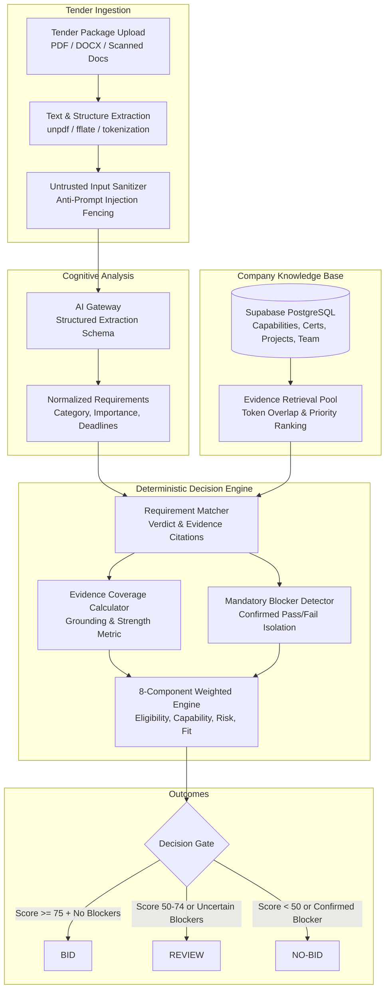

# GetBidRadar — Enterprise AI Tender Intelligence & Bid Decision Engine

<div align="center">

[](https://getbid-radar.vercel.app)
[](https://vitest.dev)
[](https://www.typescriptlang.org)
[](https://supabase.com)
[](https://vercel.com)
[](#license)

**Automate tender discovery, extract high-stakes requirements, match against verified corporate evidence, and receive deterministic Bid / Review / No-Bid recommendations.**

[Overview](#executive-overview) • [Architecture](#system-architecture) • [Features](#core-capabilities) • [Scoring Engine](#deterministic-scoring-model) • [Supabase Setup](#database--migrations) • [Vercel Deployment](#deployment-guide-vercel) • [API & Schemas](#analysis-pipeline-reference)

---

</div>

## Executive Overview

**GetBidRadar** is an enterprise-grade procurement intelligence and tender decision platform. It eliminates the single greatest operational risk in government and commercial bidding: **wasting hundreds of engineering hours pursuing disqualified or low-margin opportunities.**

Unlike generative AI wrappers that hallucinate qualification scores, GetBidRadar employs a **hybrid cognitive architecture**:

1. **AI Ingestion & Structured Extraction**: Parses complex multi-document RFP tender packages (PDF, DOCX, XLSX) into structured, categorized requirements.
2. **Lexical & Semantic Evidence Retrieval**: Matches each tender requirement against verified company past performance, personnel credentials, certifications (ISO, SOC 2, CMMI), and technical capabilities.
3. **Deterministic Mathematical Scoring**: Pure functions compute weighted component scores, derive confidence from verified evidence coverage, and strictly isolate confirmed mandatory blockers. **The LLM never generates the final bid score or recommendation.**

---

## System Architecture



---

## Core Capabilities

### 1. Hardened Server-Side AI Gateway

- **Zero API Key Leakage**: All LLM interactions are isolated strictly server-side (`gateway.server.ts`).
- **Structured Tool Enforcement**: Strict Zod schemas govern every request and response. Malformed JSON is automatically recovered or rejected before reaching business logic.
- **Failover & Bounded Retries**: Automatic backoff on HTTP 429 rate limits and HTTP 500 transient errors. Immediate termination on HTTP 402 payment requirements.
- **Audit & Token Telemetry**: Precise prompt tokens, completion tokens, and latency durations recorded in `usage_records` table.

### 2. Multi-Tiered Evidence Retrieval & Grounding

- **Hierarchical Priority**: Certifications (`1.0`) > Capabilities (`0.98`) > Past Projects (`0.96`) > Company Profiles (`0.94`) > Team Members (`0.90`) > Knowledge Base Chunks (`0.80`).
- **Evidence Verification**: Every match verdict must cite valid `evidence_ids` corresponding to actual database records in the workspace.
- **Workspace Isolation**: Multi-tenant database queries strictly bound by `workspace_id` and PostgreSQL Row-Level Security (RLS).

### 3. Deterministic Scoring Model

The model never generates arbitrary scores. The final score is computed by pure mathematical functions:

$$\text{Final Score} = \sum_{i=1}^{8} \left( \text{Score}_i \times \text{Weight}_i \right)$$

| Component Key       | Component Name                  | Weight  | Evaluation Method                                   |
| :------------------ | :------------------------------ | :-----: | :-------------------------------------------------- |
| `eligibility`       | Legal & Entity Eligibility      | **20%** | Entity status, licenses, blacklisting check         |
| `capability`        | Technical Capability Fit        | **15%** | Alignment with technical specification              |
| `experience`        | Past Performance & Track Record | **15%** | Scale, industry similarity, verified case studies   |
| `commercial_fit`    | Budget & Commercial Alignment   | **10%** | Margin feasibility, pricing competitiveness         |
| `resource_fit`      | Team & Capacity Availability    | **10%** | Staffing availability, certified personnel          |
| `deadline_fit`      | Schedule & Submission Window    | **10%** | Delivery timeline feasibility (zeroed if expired)   |
| `risk`              | Contractual & Delivery Risk     | **10%** | Penalty clauses, indemnities, liability caps        |
| `evidence_strength` | Corporate Evidence Coverage     | **10%** | Verified citation coverage across critical criteria |

#### Decision Rules

- **BID ($\ge 75$)**: Requires overall score $\ge 75$, zero confirmed mandatory failures, and $\ge 50\%$ critical evidence coverage.
- **REVIEW ($50 - 74$)**: Assigned for marginal scores or when mandatory requirements have uncertain evidence.
- **NO-BID ($< 50$)**: Immediate disqualification if score $< 50$, submission deadline has passed, or any confirmed mandatory failure is detected.

---

## Database & Migrations

GetBidRadar is backed by Supabase PostgreSQL with 50+ enterprise tables, row-level security (RLS), and database constraints.

### Schema Architecture

- `opportunities`: Core tender metadata, buyer information, submission deadlines, and pipeline status.
- `opportunity_documents`: Extracted file text, storage paths, char counts, and extraction logs.
- `opportunity_requirements`: Extracted line-item requirements, categories, weights, and compliance status.
- `opportunity_analyses`: Versioned analysis snapshots, executive summaries, fingerprints, and scores.
- `evidence_references`: Verifiable evidence citations linked to requirements and corporate assets.
- `score_components`: Breakdown of the 8 weighted components with audit rationales.
- `company_*`: Knowledge base tables (profiles, capabilities, certifications, projects, references, team members).
- `activity_logs` & `usage_records`: Immutable compliance and audit trails.

### Applied Database Migrations

Migrations are managed via the Supabase CLI in `supabase/migrations/`:

1. `20260903150219`: Baseline schema — core tables, types, relational constraints, and RLS policies.
2. `20260903150242`: Security hardening — privilege revocations on sensitive Postgres functions.
3. `20260903150322`: Storage bucket configuration and document access control policies.
4. `20260904074625`: Phase 2 intelligence engine — `inputs_fingerprint`, `blocking` flags, `confidence` metrics.

### Syncing Migrations to Supabase

To sync migrations directly to your linked Supabase project:

```bash
# Link to your Supabase project (project ref in .env)
npx supabase link --project-ref <YOUR_PROJECT_REF>

# Push migrations to remote database
npx supabase db push

# Generate fresh TypeScript definitions
npx supabase gen types typescript --linked > src/integrations/supabase/types.ts
```

---

## Deployment Guide (Vercel)

GetBidRadar is built with **TanStack Start** and fully configured for zero-configuration deployment to **Vercel** with Serverless SSR.

### 1. Prerequisites

- Vercel account linked to your Git repository.
- Linked Supabase project URL and keys.

### 2. Environment Variables Configuration

Configure the following in your **Vercel Project Settings > Environment Variables**:

| Variable                        | Type            | Description                                                |
| :------------------------------ | :-------------- | :--------------------------------------------------------- |
| `VITE_SUPABASE_URL`             | Public / Client | Supabase Project URL (`https://<project-ref>.supabase.co`) |
| `VITE_SUPABASE_PUBLISHABLE_KEY` | Public / Client | Supabase Anon / Publishable Key                            |
| `SUPABASE_URL`                  | Server          | Supabase Project URL                                       |
| `SUPABASE_PUBLISHABLE_KEY`      | Server          | Supabase Anon Key                                          |
| `LOVABLE_API_KEY`               | Server (Secret) | AI Gateway authentication token                            |

### 3. Build & Deployment Settings

The project includes a production-ready `vercel.json`:

- **Build Command**: `npm run build`
- **Output Directory**: `dist/client`
- **Install Command**: `npm install`
- **Serverless Function**: `api/server.ts` with routing to `dist/server`

To deploy manually via Vercel CLI:

```bash
# Install Vercel CLI
npm i -g vercel

# Deploy preview
vercel

# Deploy to production
vercel --prod
```

---

## Local Development & Testing

### Prerequisites

- Node.js 20+
- npm or bun

### Setup

```bash
# 1. Clone repository
git clone https://github.com/GeoffreyPaul3/getbid-radar.git
cd getbid-radar

# 2. Install dependencies
npm install

# 3. Configure environment variables
cp .env.example .env # Ensure SUPABASE_URL and LOVABLE_API_KEY are configured

# 4. Start local development server
npm run dev
```

### Verification & Quality Gates

GetBidRadar enforces four enterprise quality gates:

```bash
# 1. Automated Vitest Unit & Integration Suite (88 tests)
npx vitest run

# 2. Strict TypeScript Typechecking (zero emit errors)
npx tsc --noEmit

# 3. ESLint Code Quality Inspection
npm run lint

# 4. Production Bundle Build
npm run build
```

---

## Security & Compliance

- **Prompt Injection Defense**: All user-submitted tender documents are wrapped in isolation blocks (`src/lib/ai/untrusted.ts`) with clear delimiter boundaries. Instructions inside uploaded documents are never executed as system directives.
- **Strict Row-Level Security (RLS)**: PostgreSQL tables enforce workspace multi-tenancy. No organization can query another organization's opportunities, documents, or intelligence.
- **Idempotent Analysis Execution**: Every analysis run computes an `inputs_fingerprint` hash combining tender document updates, company signature, and engine version. Unchanged tenders return cached analyses, preventing unnecessary LLM spend.

---

## License

Proprietary and Confidential. All rights reserved © GetBidRadar.
